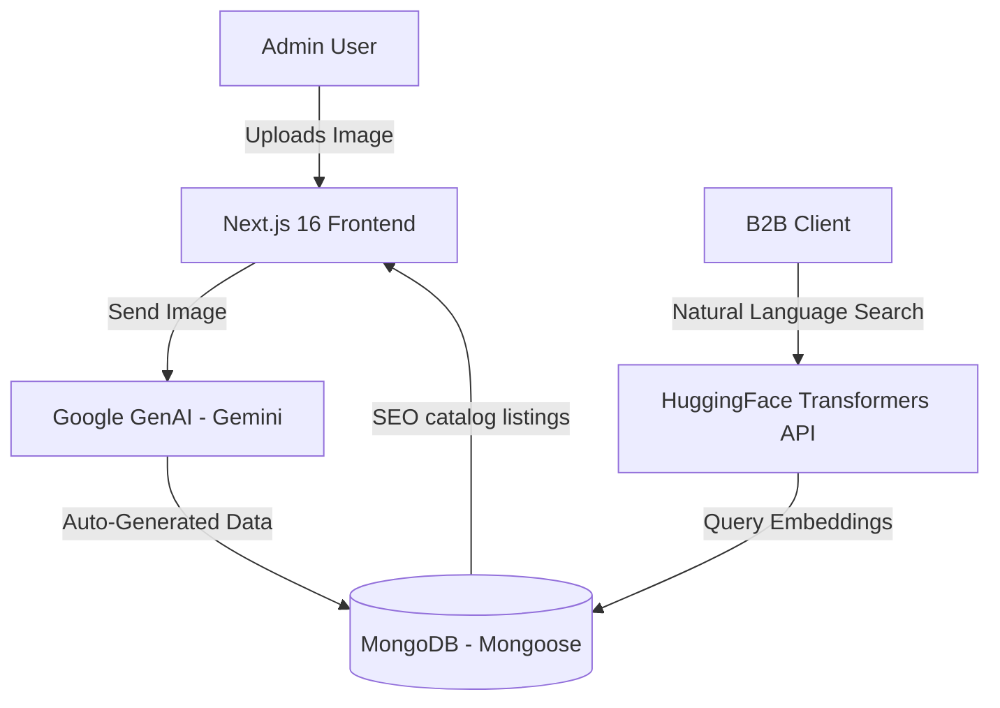

# ⚓ Corona Marine Parts — B2B Marine Spares & AI-Powered Catalog Platform

[](https://coronamarineparts.com)
[](https://github.com/Alfaz-17/corona-new)
[](https://nextjs.org)
[](https://react.dev)
[](https://tailwindcss.com)
[](https://mongoosejs.com)

Corona Marine Parts is a high-performance B2B platform specializing in the global export of genuine marine spare parts, ship engine components, and automation systems sourced directly from Alang Shipyard, India. The application features advanced Gemini-driven automated catalogs and AI-assisted vector/semantic search.

---

## 🌟 Architectural Features & Design Patterns

### 1. 🤖 AI-Powered Product-Listing Pipeline (Google GenAI)
* **Image Recognition**: Admin uploads raw images of marine components (e.g., fuel injectors, turbochargers, PLCs).
* **Gemini Analysis**: Processes the image using the `@google/genai` SDK to:
  * Extract manufacturing stamps, serial numbers, and equipment models.
  * Auto-generate technical SEO titles and descriptions.
  * Dynamically map products to correct sub-categories.
  * Generate key tags (e.g., *"refurbished engine parts"*, *"marine PLC module"*).
* **Efficiency**: Eliminates manual product listing forms, streamlining catalogue building for 4 sister marine B2B sites.

### 2. 🔍 Semantic & AI-Assisted Product Search (HuggingFace Transformers)
* **Transformer Embeddings**: Uses `@huggingface/transformers` to parse user queries, allowing semantic search matching (e.g., query *"parts to regulate water pressure"* resolves to *pressure relief valves* even if the title doesn't match the exact words).
* **Smart Filtering**: Integrates vector similarity-based search directly alongside standard lexical regex queries in MongoDB.

### 3. 🌐 Advanced B2B SEO & Global Optimization
* **Structured Data**: Implements JSON-LD Schema.org formats for Products, Organizations, and FAQs to boost Google index quality.
* **Metadata & Dynamic Sitemaps**: Next.js App Router metadata generates dynamic canonical headers, image sitemaps, and `/sitemap.xml` entries per product listing.
* **Responsive Styling**: Designed using **Tailwind CSS v4** and **Framer Motion** for smooth, lightweight transitions on both mobile and desktop devices.

---

## 🏗️ System Architecture



---

## 📂 Codebase Directory Structure

```bash
corona-marine-new/
├── app/
│   ├── about/            # Corporate profiles & Alang Shipyard supply chain info
│   ├── admin/            # CMS Dashboard for catalog management (AI ingestion)
│   ├── api/              # API router (auth, AI category mapper, inquiries)
│   ├── blog/             # Maritime spares news and maintenance guides
│   ├── products/         # Dynamic product sheets, details, and inquiry links
│   ├── layout.tsx        # Next.js global provider configurations
│   ├── page.tsx          # Homepage with SEO optimizations
│   └── sitemap.ts        # Automated XML sitemap generation script
├── components/
│   ├── boty/             # Modular web UI sections (Hero, Featured, CTAs)
│   └── ui/               # Core design elements
├── lib/
│   ├── gemini.ts         # Gemini SDK client configuration
│   ├── mongoose.ts       # MongoDB connection manager
│   └── transformers.ts   # HuggingFace tokenization config
├── package.json
└── README.md
```

---

## 📊 Database Schema Design (Mongoose)

### **Product Schema**
```javascript
{
  title: { type: String, required: true, index: true },
  slug: { type: String, unique: true, index: true },
  description: { type: String, required: true },
  partNumber: { type: String },
  category: { type: String, required: true },
  brand: { type: String, required: true },
  images: [{ type: String }],
  specifications: { type: Map, of: String },
  tags: [{ type: String }],
  aiMeta: {
    generatedAt: { type: Date },
    confidence: { type: Number },
    originalImageHash: { type: String }
  },
  isInStock: { type: Boolean, default: true }
}
```

### **Inquiry Schema**
```javascript
{
  product: { type: Schema.Types.ObjectId, ref: 'Product' },
  clientName: { type: String, required: true },
  companyName: { type: String },
  email: { type: String, required: true },
  phone: { type: String, required: true },
  message: { type: String, required: true },
  status: { type: String, enum: ['New', 'Contacted', 'Quoted', 'Closed'], default: 'New' }
}
```

---

## 📡 API Reference

### Catalog & Search APIs
* **`GET /api/products`**: Fetch product catalog with standard pagination and category filtering.
* **`POST /api/products/search`**: Processes natural language search queries through semantic embedding models.

### Admin & AI Ingestion APIs
* **`POST /api/admin/ai-ingest`**: Receives product images, calls Gemini, and returns parsed fields for confirmation.
* **`POST /api/admin/products`**: Inserts verified AI-suggested product entries into MongoDB.

### Contact & Lead Routing
* **`POST /api/inquiries`**: Creates a lead record and triggers an email notification to admins via **Resend/Nodemailer**.

---

## ⚙️ Installation & Setup

### 1. Prerequisites
* Node.js (v18+)
* MongoDB connection URI
* Resend API Key or SMTP credentials
* Gemini API Key

### 2. Configure Environment Variables (`.env.local`)
Create a `.env.local` file in the root directory:
```env
MONGODB_URI="mongodb+srv://<user>:<password>@cluster.mongodb.net/coronamarine"
JWT_SECRET="your-jwt-signing-secret"

# Google GenAI Credentials
GEMINI_API_KEY="your-gemini-api-key"

# Resend API Setup
RESEND_API_KEY="re_your_api_key"
ADMIN_EMAIL="sales@coronamarineparts.com"
```

### 3. Start Development Server
```bash
# Install dependencies
npm install # or pnpm install

# Start local server
npm run dev
```
Open [http://localhost:3000](http://localhost:3000) to view the portal.